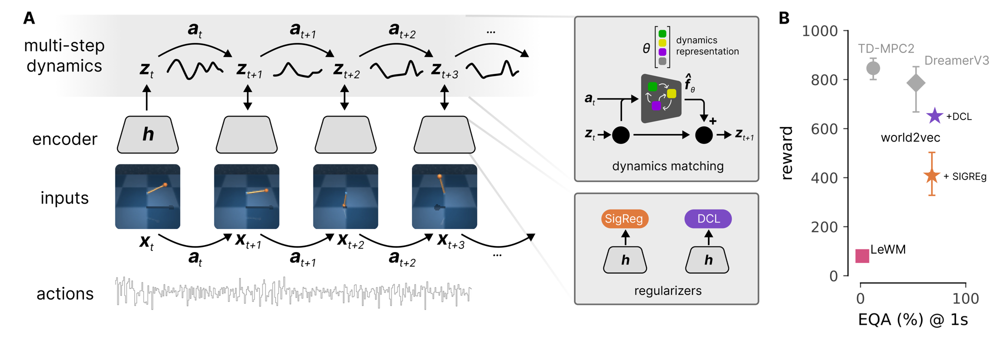

# world2vec: Mechanistic world models through latent dynamics learning

Tobias Schmidt<sup>\*</sup>, Rodrigo González Laiz<sup>\*</sup>, Krisztián Szuppinger & Steffen Schneider\
Helmholtz Munich & Munich Center for Machine Learning (MCML)

<sup>\*</sup>Equal contribution

[Project page](https://worldmodels.science/world2vec)



**A.** World2vec jointly learns representations and dynamics in latent space; the dynamics model is an action-conditioned neural ODE which can be parameterized to provide an interpretable vector representation of the dynamics. The objective function incorporates assumptions about the underlying data-generating process.
**B.** Reward vs. 1 s Equivariance Accuracy (EQA) of world2vec vs. baselines, averaged across environments.

## Abstract

World models can achieve strong control performance without faithfully capturing the dynamics of their environment, limiting their potential for mechanistic interpretability and scientific discovery. Here, we introduce world2vec to learn mechanistic world models without reward information directly from observations and actions. World2vec learns latent dynamics that faithfully reproduce the true system over long prediction horizons, with at least one order of magnitude fewer parameters than DreamerV3, TD-MPC2 and LeWM. This enables state of the art performance in controlling continuous environments from pixels and accurate system identification across a benchmark of 71 attractors, demonstrating how world models are amenable to scientific discovery.

## Code

The code will be released here soon. Star or watch this repository to be notified when it is available.

## Citation

```bibtex
@article{schmidt2026world2vec,
  title   = {{world2vec}: Mechanistic world models through latent dynamics learning},
  author  = {Schmidt, Tobias and Gonzalez Laiz, Rodrigo and Szuppinger, Krisztian and Schneider, Steffen},
  journal = {arXiv preprint},
  year    = {2026}
}
```
